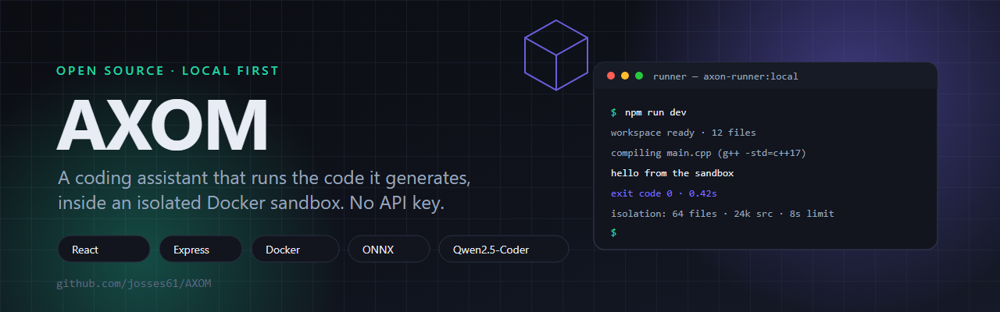

# AXOM — Local coding assistant



AXOM is a local-first AI coding assistant. You describe what you want in one prompt, AXOM
generates the project files into an editable workspace, and then runs the result for you in an
isolated Docker sandbox. The model runs on your machine — no API key, no cloud, no telemetry.

Everything happens on your own hardware: the LLM is a quantized ONNX build of Qwen2.5-Coder
executed through `@huggingface/transformers` inside the Node server.

---

## What it does

| | |
|---|---|
| **Prompt to project** | One prompt produces a full set of project files that you can edit in the workspace view. |
| **Isolated runner** | Generated code is executed in a disposable Docker container, not on your machine. |
| **Multi-language** | The runner compiles and runs C, C++, Go, Java, Rust, JavaScript, MJS and Python. |
| **Web context** | Scrape a page so the assistant can work from live documentation instead of guessing. |
| **Persistent knowledge** | Learned examples and preferences are stored locally and injected into later prompts. |
| **GitHub round-trip** | Import an existing repo, generate against it, then publish a new repo from the workspace. |

### Server API

The Express backend exposes the whole feature set as a small JSON API:

```
GET  /health                 service status
POST /project                generate a project from a prompt
POST /project/update         revise an existing project
POST /run                    execute the workspace in the isolated runner
POST /web/scrape             fetch and extract page text for context
GET  /knowledge              read the local knowledge base
POST /knowledge              write a knowledge entry
POST /learning               record a learned example
GET  /profile                read the local profile
POST /profile                update the local profile
GET  /model                  current model / profile information
POST /load                   load the model into memory
POST /agent                  multi-agent run (up to 8 agents, with a report)
GET  /github/status          GitHub connection status
GET  /github/repos           list your repositories
POST /github/import          import a repository into the workspace
POST /github/create          create a repository from the workspace
POST /github/publish         publish the workspace to a repository
```

---

## Requirements

- **Node.js 18 or newer**
- **Docker** — only needed for the code runner (`npm run runner:build` once)
- Roughly 1–2 GB of disk for the downloaded ONNX model and its cache

No API keys. No accounts. The model download happens on first run and is cached in
`./.cache/huggingface`.

---

## Quick start

```bash
git clone https://github.com/josses61/AXOM.git
cd AXOM

npm install

# Build the isolated runner image (once)
npm run runner:build

# Start the client and the server together
npm run dev
```

The client runs on <http://localhost:5173> and the API server starts alongside it.

### Scripts

| Command | What it does |
|---|---|
| `npm run dev` | Runs the Vite client and the Express server together |
| `npm run dev:client` | Client only, on port 5173 |
| `npm run dev:server` | API server only |
| `npm run build` | Type-checks and builds the client for production |
| `npm run runner:build` | Builds the `axon-runner:local` Docker image |
| `npm run preview` | Serves the production build locally |
| `npm run server` | Runs the API server on its own |

---

## Configuration

All settings are environment variables read by the server.

| Variable | Default | Meaning |
|---|---|---|
| `AXOM_MODEL` | `onnx-community/Qwen2.5-Coder-0.5B-Instruct` | Model for the `AXOM1.0` profile |
| `AXOM_MODEL_1_1` | `onnx-community/Qwen2.5-Coder-1.5B-Instruct` | Model for the `AXOM1.1` profile |
| `AXOM_MODEL_PROFILE` | `AXOM1.1` | Which model profile to load |
| `AXOM_MODEL_DTYPE` | `q4` | Quantization used when loading the model |
| `AXOM_MODEL_CACHE_DIR` | `./.cache/huggingface` | Where the model is cached |
| `AXOM_KNOWLEDGE_FILE` | `./.cache/axom-knowledge.json` | Local knowledge base file |
| `DOCKER_COMMAND` | `docker` | Executable used to start the runner |

Use the smaller 0.5B model on a low-memory machine and switch to 1.5B when you want better code:

```bash
AXOM_MODEL_PROFILE=AXOM1.0 npm run dev
```

---

## How the isolated runner works

Generated code never touches your working copy. AXOM sends the workspace files to a short-lived
Docker container over stdin, the container writes them to a scratch directory, compiles and runs
the entrypoint, and streams back stdout, stderr, the exit code and any timeout.

The runner is deliberately restrictive:

- **64 files** maximum in a workspace, **24,000 characters** of source in total
- **48,000 characters** of combined stdout and stderr
- **4,000 characters** of stdin
- A hard timeout — the process group is killed if it overruns
- The Java runtime is capped at one active processor and a 96 MB heap

Paths are validated before anything is written: absolute paths, drive letters, backslashes and
`..` segments are rejected, so a file name cannot escape the scratch directory.

Build the runner yourself and AXOM will not use anything else:

```bash
docker build -t axon-runner:local ./runner
```

If that image is missing, AXOM tells you to run `npm run runner:build` rather than failing with a
confusing Docker error.

---

## Project layout

```
AXOM/
├── index.html            client entry point
├── src/                  React + TypeScript UI (workspace, chat, runner output)
├── server/
│   ├── index.js          server bootstrap
│   └── api-router.js     all endpoints, model loading, runner, GitHub integration
├── runner/
│   ├── Dockerfile        the isolated execution image
│   └── runner.js         compiles and runs a workspace, enforces the limits
├── .cache/               model cache, knowledge base and profile (git-ignored)
├── Dockerfile            image for deploying the app itself
└── fly.toml              deployment configuration
```

---

## Privacy

AXOM does not call out to any hosted model. The model weights are downloaded once from the Hugging
Face CDN, then everything — prompts, generated code, learned examples, your profile — stays in the
local `.cache` directory and in the Docker sandbox.

---

## Contributing

Issues and pull requests are welcome. If you want to add a language to the runner, the entrypoint
map in `runner/runner.js` is the place to start, and the corresponding compiler has to exist in
`runner/Dockerfile`.

---

## License

No license file has been added yet. Ask before reusing the code.
